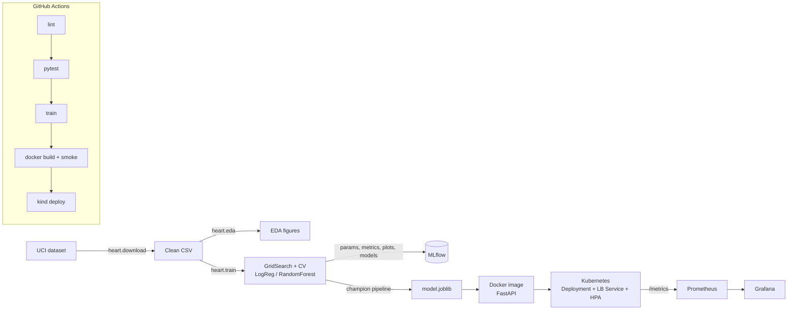

# Heart Disease Risk — End-to-End MLOps

Predicts heart-disease risk from the UCI Cleveland dataset and serves it as a
containerised, monitored FastAPI service on Kubernetes.



## Repository layout
| Path | Purpose |
|---|---|
| `heart/download.py` | Download UCI data, clean, validate, write `data/processed/heart_clean.csv` |
| `heart/eda.py` | Class balance, histograms, correlation heatmap, categorical rates, outliers |
| `heart/features.py` | Shared `ColumnTransformer` (impute → scale / one-hot) |
| `heart/train.py` | GridSearchCV per model, 5-fold CV metrics, MLflow logging, champion export |
| `heart/predict.py` | Offline batch inference |
| `app/main.py` | FastAPI: `/predict`, `/health`, `/model-info`, `/metrics` + JSON request logs |
| `test/` | Pytest for data, features, training, API |
| `.github/workflows/ci.yml` | lint → test → train → docker smoke → kind deploy |
| `k8s/` | Namespace, Deployment, LoadBalancer Service, NGINX Ingress, HPA (`k8s/kind/` = local cluster config) |
| `monitoring/` | Prometheus + Grafana (provisioned dashboard) + load generator |
| `screenshots/` | Evidence for the report |

## Quick start
```bash
python -m venv .venv && source .venv/bin/activate
pip install -r requirements-dev.txt

python -m heart.download     # data
python -m heart.eda          # figures -> reports/figures
python -m heart.train        # MLflow runs -> ./mlruns, model -> models/
mlflow ui --backend-store-uri ./mlruns   # http://localhost:5000
pytest -v
```

## Serve
```bash
uvicorn app.main:app --port 8000          # docs at http://localhost:8000/docs
curl -X POST localhost:8000/predict -H 'Content-Type: application/json' -d @sample_request.json
```
Response:
```json
{"prediction": 1, "label": "disease", "confidence": 0.80, "probability_disease": 0.80,
 "model_version": "20261019050453", "request_id": "..."}
```

## Docker
```bash
docker build -t heart-api:1.0.0 .      # requires models/ from the training step
docker run --rm -p 8000:8000 heart-api:1.0.0
```

## Kubernetes (Minikube)
```bash
minikube start
minikube image load heart-api:1.0.0
kubectl apply -f k8s/
kubectl -n heart-mlops get pods,svc
minikube tunnel                         # separate terminal: assigns the LoadBalancer IP
curl -X POST http://<EXTERNAL-IP>/predict -H 'Content-Type: application/json' -d @sample_request.json
```
For EKS/GKE/AKS, point the Deployment image at the GHCR image CI pushes
(`ghcr.io/<owner>/<repo>/heart-api:<sha>`).

## Monitoring
```bash
docker compose -f monitoring/docker-compose.yml up --build -d
./monitoring/load_test.sh http://localhost:8000 300
```
Prometheus: http://localhost:9090 · Grafana: http://localhost:3000 (dashboard *MLOps → Heart Disease API*).
Every request is logged as one JSON line (request id, path, status, latency).
